<p align="center">
  
</p>

<h1 align="center">Concours</h1>

<p align="center"><b>Fraud models that keep up with fraudsters.</b></p>

<p align="center">
  A working payment-fraud model and a daily review queue on day one, from your own transactions.<br/>
  A global network of solvers keeps improving it as fraud changes. A new version goes live only when it proves it is better.
</p>

<p align="center">
  <a href="https://concours-demo-49wqv46v5pghxqr-3000.app.github.dev"><b>Try it live</b></a> ·
  <a href="#how-to-evaluate">How to evaluate</a> ·
  <a href="#screens">Screens</a> ·
  <a href="#how-it-works">How it works</a> ·
  <a href="#run-it-locally">Run it locally</a>
</p>

<p align="center">
  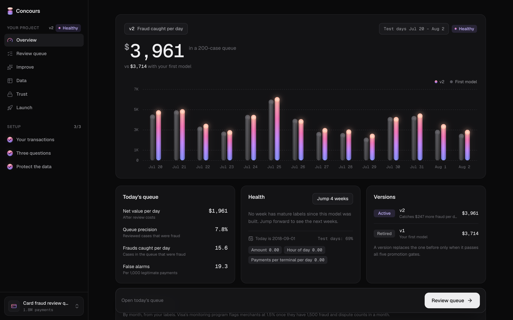
</p>

---

## The problem

Fintechs, payment companies and marketplaces lose money to fraud every day. Most have a fraud team: analysts who
review suspicious payments. Few have an ML team. Their options today:

- **Rules** that fraudsters learn to step around within weeks.
- **A vendor score** that is a black box, trained on someone else's data, and slow to change.
- **Hiring data scientists**, which takes months, and the model they ship starts going stale the day it launches.

Fraud keeps changing (card testing, cash-out rings, new merchant patterns). A model that is not retrained keeps
getting worse.

## What Concours does

The fraud lead uploads transactions, maps five columns, and answers three questions about the team:

1. How many cases can the team review per day? (default 200)
2. What does one review cost, and is there a fee on a missed fraud? (default 10, 0)
3. How long until fraud is confirmed, for example through chargebacks? (default 30 days)

In the same sitting they get:

- **A protection report.** IDs are scrambled, card numbers are removed, and columns that would let a model cheat
  are caught. Late labels are handled with an embargo.
- **A working fraud model (v1)**, measured as money: *fraud caught per day inside the team's review capacity*.
- **Today's review queue**: payments ranked by expected loss, cut at the team's capacity, with three plain-English
  reasons per case. Analysts mark each case Fraud or Not fraud, and those verdicts become new labels.

Then the model keeps improving. Weekly health and drift checks show when fraud changes. An improvement round
starts, and code from **outside solvers** competes to beat the active model on recent days it never saw. A new
version is promoted **only if it passes five gates** on a private holdout. Nobody at the customer touches a model.

> Delivery is a daily batch queue sized to analyst capacity. Real-time scoring at checkout is out of scope.

## How to evaluate

**Hosted copy:** https://concours-demo-49wqv46v5pghxqr-3000.app.github.dev

1. GitHub first shows a one-time page, *"You are about to access a development port…"*. Press **Continue**.
2. You land on the Concours website. Press **Get started** in the hero or the nav.
3. Create an account. You get your own empty workspace.
4. Choose **Try with sample data** (1.75M simulated card payments) or upload your own CSV. Then go through
   *Your transactions → Three questions → Protect the data*. v1 and today's queue are built automatically.
5. Open **Review queue**, **Improve** and **Trust** to see the queue, the attempts with their gates, and exactly
   what leaves the machine.

The hosted copy runs in a free GitHub Codespace. If the link does not respond, the codespace has been stopped
for idleness; ask the team to wake it.

## Screens

| | |
|---|---|
| 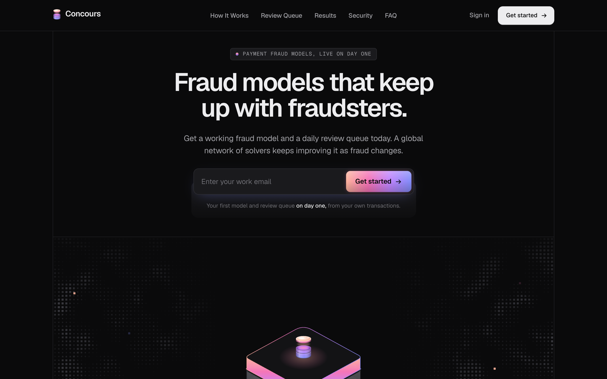 | 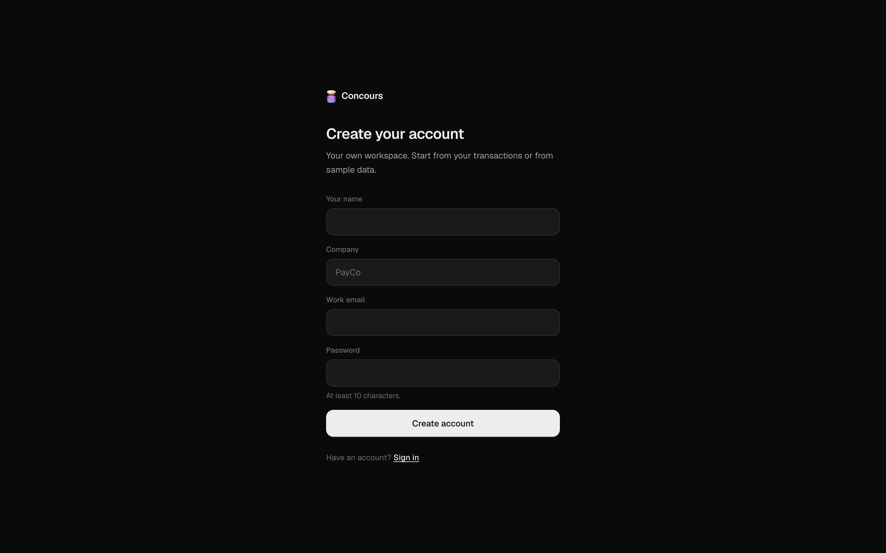 |
| **Website.** The link opens here; *Get started* leads to sign-up. | **Sign-up.** Own workspace, straight into the platform. |
| 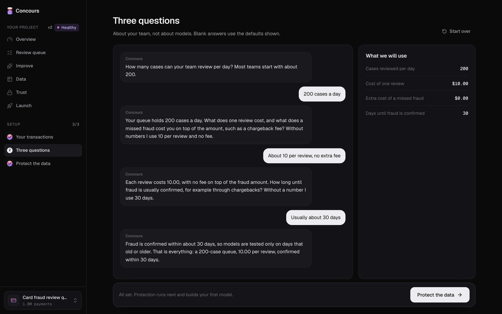 | 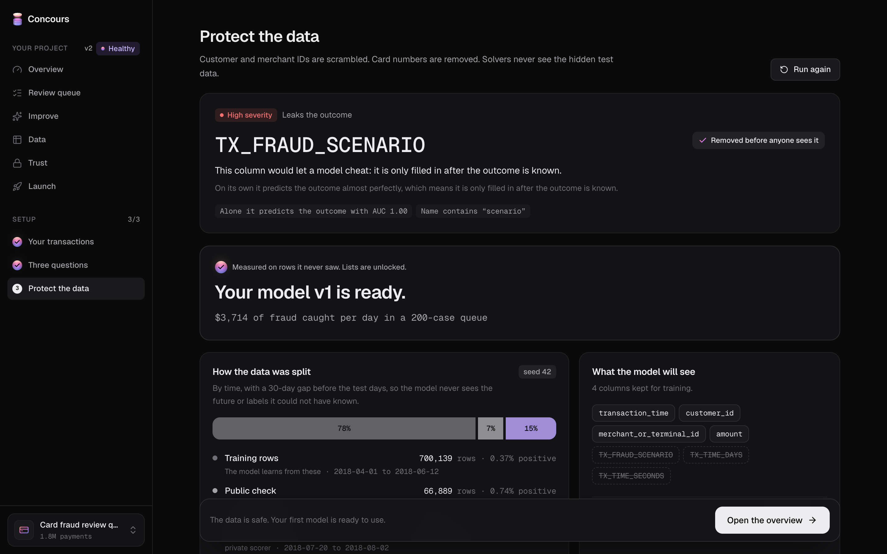 |
| **Three questions.** About the team, not about models. Every number is parsed in code. | **Protect the data.** Scrambled IDs, leak checks, late labels, then v1 builds. |
|  | 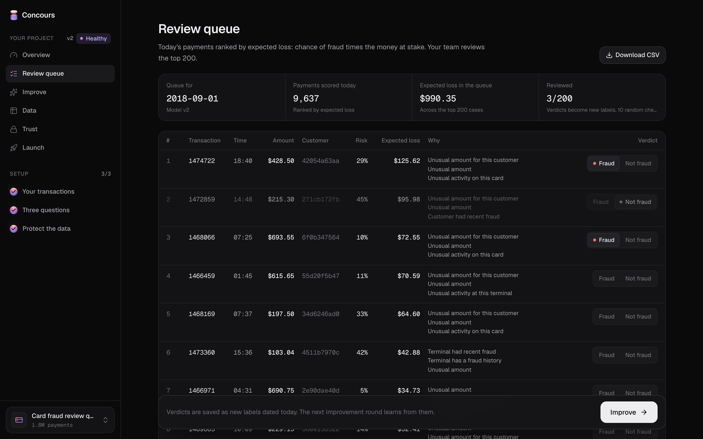 |
| **Overview.** Fraud caught per day by v2 against the first model, health, versions. | **Review queue.** Ranked by expected loss, cut at capacity, reasons and verdicts. |
| 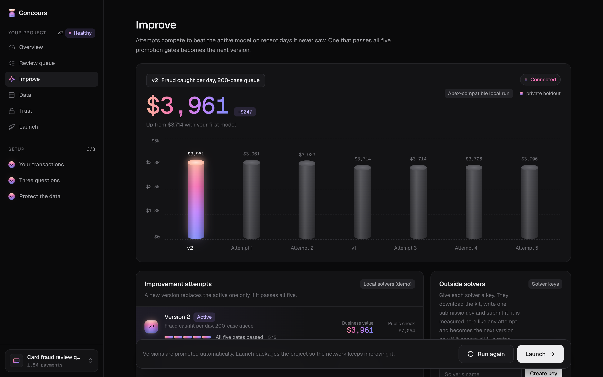 | 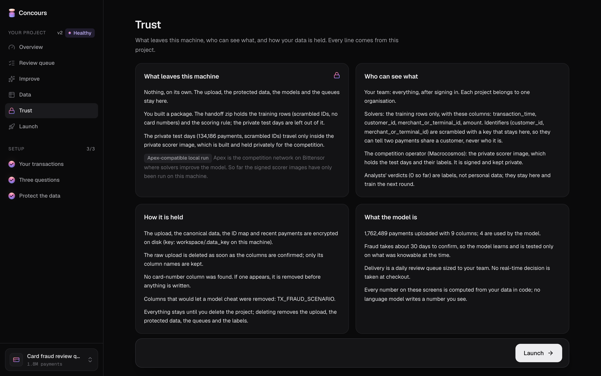 |
| **Improve.** Attempts against the active version, the five gates, outside solver keys. | **Trust.** What leaves the machine, who sees what, how data is held. |
| 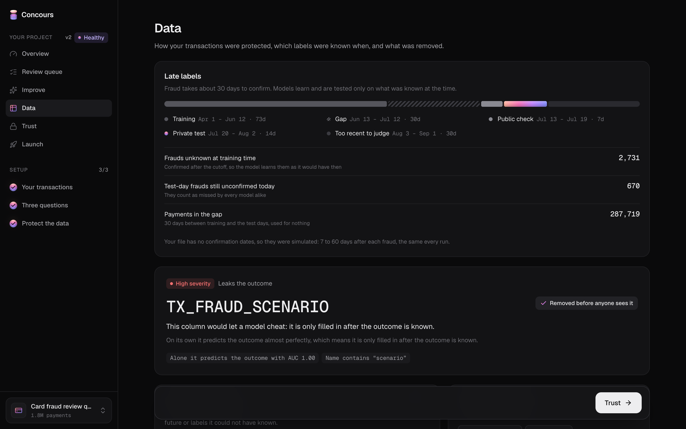 | 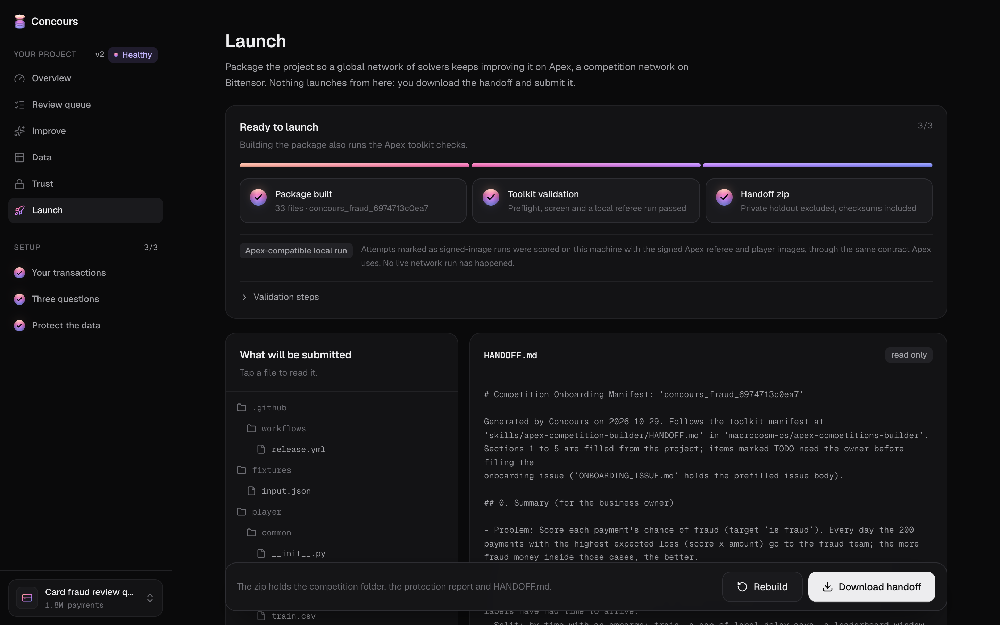 |
| **Data.** Protection report, late-label timeline, findings. | **Launch.** The competition package for the solver network, checked and read-only. |

## How it works

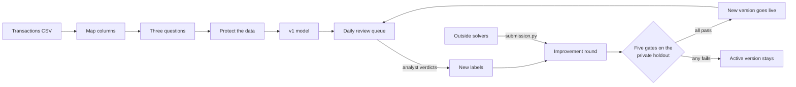

### 1. Measured as money, inside capacity

Every result is one number the fraud lead already cares about: **fraud money caught per day in a queue the team
can actually review**. For each test day, payments are ranked by `score × (amount + fee)` and the top
`daily_capacity` are "reviewed". Concours also reports frauds per day, queue precision, false alarms per 1,000
legitimate payments, and net value per day after review costs (`backend/app/shared/metrics.py`).

In the seeded demo project, v1 catches **$3,714/day** in a 200-case queue. v2, from an improvement round, catches
**$3,961/day** on the same days.

### 2. Honest about late labels

Fraud is confirmed weeks after the payment. A model tested on labels it could not have known looks better than it
is. From the simulated "today" E and the confirmation delay D (`backend/app/fraud/labels.py`):

```
… train … | embargo (D days, dropped) | leaderboard (7 days) | private holdout (14 days) | immature (D days, queue + drift only) | E
```

Training labels are as known at the training cutoff; evaluation labels are as known at E. Missing label times are
simulated. Analyst verdicts override labels from the day they are given.

### 3. Promotion is earned: five gates

A new version replaces the active one only if it passes **all five** on the private holdout
(`backend/app/fraud/gates.py`):

| Gate | Rule |
|---|---|
| Hidden data | Scored on days the solver never saw. Public scores never decide. |
| Same rows | Challenger and champion are scored on identical payments. |
| Luck test | Day-block bootstrap, 1,000 resamples; the challenger must win in at least 95%. |
| No segment regression | No drop over 5% for small, medium or large amounts, or for new or returning customers. |
| Speed | 10,000 rows scored in under 5 seconds. |

### 4. Drift is watched, not guessed

Weekly health on mature weeks compares the share of fraud money caught with the holdout. A relative drop over 15%
or a PSI over 0.2 (amount, hour of day, payments per terminal per day) marks the model as *slipping* and starts a
round. `scripts/inject_drift.py` adds a card-testing then cash-out pattern so the demo can show a version that
adapts (`lgbm_velocity` catches it).

### 5. Outside solvers improve it

Three ways outside code becomes an attempt. All are scored the same way: player container, referee, private
holdout, five gates.

| Path | How | Status |
|---|---|---|
| **Solver keys** | The owner creates a key on *Improve*. The solver runs `concours solve kit`, writes `submission.py`, and runs `concours solve submit`. | Works today, on any Concours server. |
| **Concours subnet on Bittensor** (`subnet/`) | Miners commit the hash of their `submission.py` on chain. The Concours validator scores it and sets weights to the winner. | Live on **testnet, netuid 603**: a miner's solver became v2 and weights were set on chain. |
| **Apex** (Macrocosmos, Bittensor subnet 1) | The *Launch* screen builds a push-ready competition repo: spec, player and referee images, a signed release workflow, and a prefilled onboarding issue. | Package built and validated locally with the signed images; waiting on activation. |

A submission is one `submission.py` under 200 KB with `class Solver(SolverBase)` (`fit`, `predict_proba`). Before
it runs, it is screened: allowlisted imports only, and no `exec`, `eval`, `open` or `__import__`. It runs with no
network, 2 CPUs and 2 GB. The private holdout never leaves the Concours server.

### 6. Data protection by default

- IDs are hashed with a per-project key that stays on the server. Card-number columns never reach disk.
- Leak columns (for example `TX_FRAUD_SCENARIO`), future information and clock counters are caught and removed.
- Uploads, the canonical dataset, the ID map and recent payments are encrypted at rest. The raw upload is deleted
  once columns are confirmed.
- Solvers see only training rows with scrambled IDs. The private test days travel only inside a signed, private
  scorer image.
- No language model writes a number the user sees. The intake assistant only asks the three questions; answers are
  parsed in code.

## Architecture

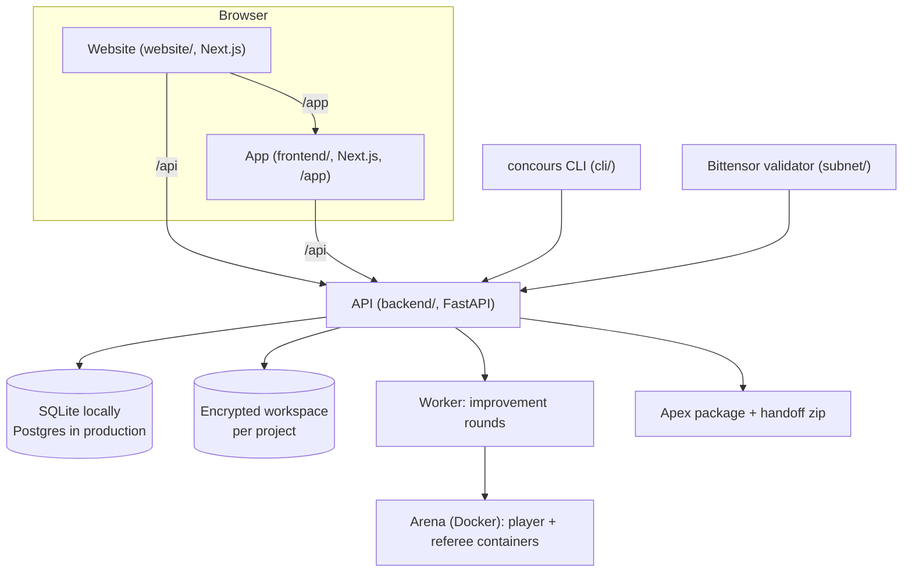

| Layer | Tech |
|---|---|
| Website and app | Next.js 15, React 19, Tailwind CSS 4, Geist |
| API and worker | Python 3.11, FastAPI, SQLModel, pandas, scikit-learn, LightGBM |
| Model runs | Docker: a gym_v1 player and a referee container per attempt, the same contract as Apex |
| Accounts | Organisations, scrypt passwords, session cookies, API keys, invites |
| Solver network | Bittensor SDK and btcli (own subnet), Apex competitions toolkit |
| Intake assistant | Claude (API key or Claude Code CLI), with cached defaults when offline |

## Run it locally

Requirements: Docker Desktop, Python 3.11 with [`uv`](https://docs.astral.sh/uv/), Node 22 with `pnpm`.

```bash
./scripts/demo.sh   # fetch the fraud sample and seed the demo projects (under 2 minutes with a warm .cache/)
./scripts/dev.sh    # API on :8000, app on :3000 (open http://localhost:3000/app)
```

The seed creates the demo owner (`CONCOURS_DEMO_EMAIL` from `.env.example`) and writes a generated password to
`.env` (gitignored). Set `CONCOURS_AUTH=off` in `backend/.env` for single-user local use, or `CONCOURS_SIGNUP=open`
to let anyone create an account.

To run the website in front of the app, as on the hosted copy:

```bash
cd website && pnpm install && CONCOURS_APP_URL=http://127.0.0.1:3000 pnpm dev --port 3002
# open http://localhost:3002, then Get started
```

The intake assistant and the agent solver use, in order: `ANTHROPIC_API_KEY` in `backend/.env`, the Claude Code CLI
signed in on your subscription, or cached replies.

**Command line:** `pipx install ./cli`, then `concours login --url http://127.0.0.1:8000` and `concours --help`.

**Tests:** `make test`, or `cd backend && .venv/bin/python -m pytest -q` and `cd frontend && pnpm test` (copy lint
and type check).

**Production:** `docs/DEPLOY.md` covers one VM with Docker Compose, Postgres, Caddy and HTTPS.

## Repository layout

```
backend/    FastAPI app
  app/fraud/      schema, late labels, protection, gates, promotion, queue reasons, drift
  app/arena/      Docker rounds, signed-image runs, live event stream
  app/solve.py    outside solver keys and submissions
  app/chain.py    Bittensor validator intake
  solvers/        local solvers (baseline, LightGBM variants, velocity features)
  player/ referee/  the gym_v1 player and the money-per-day referee
frontend/   the app (served under /app): setup, Overview, Review queue, Improve, Data, Trust, Launch
website/    the marketing site that fronts the hosted link
subnet/     Concours's own Bittensor subnet: miner, validator, testnet runbook
cli/        the concours command line
data/       fraud sample source and drift injection; other template datasets
docs/       product, Apex contract, demo script, deploy, audits
vendor/     gym_v1, vendored from the Apex toolkit
```

## Further reading

| Document | What it covers |
|---|---|
| [`CONCOURS.md`](CONCOURS.md) | Product overview: flow, metric, gates, drift, endpoints, copy rules |
| [`docs/APEX_CONTRACT.md`](docs/APEX_CONTRACT.md) | The verified Apex competition contract and where Concours fits it |
| [`subnet/README.md`](subnet/README.md) | The Bittensor subnet and its testnet runbook |
| [`docs/DEMO_SCRIPT.md`](docs/DEMO_SCRIPT.md) | The three-minute demo |
| [`docs/MODELLING_PLAN.md`](docs/MODELLING_PLAN.md) | Modelling choices and the solvers |
| [`docs/DEPLOY.md`](docs/DEPLOY.md) | Production deployment |
| [`docs/audits/`](docs/audits/) | Security and journey audits |

## Data credits

Fraud: simulated transactions from the *Fraud Detection Handbook* (ULB Machine Learning Group), see
`data/templates/fraud/SOURCE.md`. Churn: UCI Iranian Churn dataset, CC BY 4.0. Leads: UCI Bank Marketing dataset,
CC BY 4.0.
