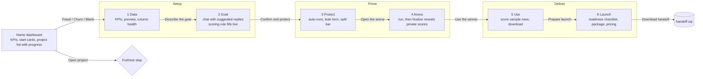

# Brief UX flow: current and optimised

Persona: Priya, fraud lead at a lender. She has a spreadsheet and no ML team. She wants a model she can
trust, a number her boss understands, and a package she can hand to Apex. She may open Brief on a laptop
during a demo or on her phone between meetings.

## 1. Current journey (as built in e382bf9)

```mermaid
flowchart LR
  H[Home<br/>3 template cards + project table] -->|Fraud / Churn| I
  H -->|Start blank| U[1 New problem<br/>dropzone, profile tables]
  U -->|Continue| I[2 Describe the goal<br/>chat + 15-field spec form]
  I -->|Confirm spec, auto-redirect| P[3 Protect the data<br/>empty until 'Run protection']
  P -->|click Run protection| P2[Report: leak card, split chart, findings]
  P2 -->|Continue at page bottom| A[4 Arena<br/>3 header buttons: Validate, Run, Finalize]
  A -->|Run local solvers| A2[Rows stream in]
  A2 -->|Finalize| A3[Private scores revealed]
  A3 -->|Continue at page bottom| S[5 Use the winner]
  S -->|Use sample rows| S2[Scored preview + download]
  S2 -->|Continue| L[6 Launch on Apex<br/>Build package, file tree, pricing, terms]
  L -->|Download| Z[(handoff.zip)]
  X[Header Fraud / Churn buttons] -.->|creates a NEW project every click| I
```

### Friction found

| # | Where | Problem | Effect |
|---|---|---|---|
| 1 | Home to Goal | Templates skip step 1, so the data preview is never seen, yet step 1 shows as done. | The demo line "the dataset loads, 10-row preview" has no screen. Users never see what they are about to protect. |
| 2 | Header | Fraud / Churn buttons create a new project on each click. | Silent project clutter; switching looks like navigation but is creation. |
| 3 | Stepper | `grid-cols-6` of pills at every width. | At 375 px each pill is about 50 px wide: labels truncate to nothing. |
| 4 | Goal | Chat and a 15-field form compete side by side. Fields use ML words (positive label, allowed libs, ms per row). | The non-ML persona sees the hard part first. On mobile the form sits under a 560 px chat. |
| 5 | Goal | The user must type the expected answers from memory. | Demos stall on typing; offline replies need specific phrasings. |
| 6 | Protect | Arrives empty; needs a second click although the step is deterministic and takes seconds. | One dead screen per project. |
| 7 | Arena | Three peer buttons (Validate, Run, Finalize) with equal weight; validation belongs to launch. | Unclear what to do next; Finalize, the gate to the next step, looks optional. |
| 8 | Arena | The result is a sentence in a blue box; scores are 4-decimal floats in a table. | The money moment (22% to 30%) does not read at a glance. |
| 9 | Every step | "Continue" sits at the bottom of long pages. | On a phone the next action is 3 to 6 screens away. |
| 10 | Tables | Wide tables (preview, leaderboard, projects) overflow at phone widths. | Horizontal page scroll, clipped columns. |
| 11 | Launch | Package build is a separate action that repeats arena validation. | Two places to validate, neither tells you if you are ready. |
| 12 | Revisit | Opening a project jumps to its furthest step; Home shows no results. | No overview of what a project achieved. |
| 13 | Visual | Generic light stone theme, system font, no numeric typography. | Numbers, the product's output, have no hierarchy. |

## 2. Optimised journey

Principles: one primary action per screen, always visible; plain words first, details on demand; never
show an empty step that the app could fill itself; numbers set in a monospace face so they line up and
read as data.

### What changed and why

| Fix for | Change |
|---|---|
| 1 | Templates land on **Data**: rows, columns, outcome rate as large figures, a 10-row preview, and per-column health bars. One button: "Describe the goal". |
| 2 | Template switching lives only on Home, labelled "Start". On phones Home shows the start options as compact rows above the project list; project counts are small chips, not large tiles. |
| 3, 9 | Progress is a 6-segment bar (done, current, locked) with "Step 3 of 6". Desktop: a labelled sidebar groups the steps by phase (Setup, Prove, Deliver) with done, current and locked states; it replaces the earlier icon rail, breadcrumb bar and progress strip. Mobile: one sticky header shows the project, the current step and a gradient progress line; tap the step chip to open a step sheet. Each step ends in a **sticky action bar** holding the single primary action, pinned above the home indicator on phones. |
| 4 | Goal is chat-first. The right panel is a plain-language **scoring rule** that ticks off four parts as the chat fills them (outcome, how we score, split, economics). The raw form moves into "Fine-tune". On mobile, a Chat / Rule switch replaces the side-by-side layout. |
| 5 | Numbered **suggested replies** under the chat (fraud and churn templates, and outcome-column guesses for a blank CSV). One tap sends. |
| 6 | Protect **runs on arrival** when there is no report yet, showing the seven checks. "Run again" stays available. |
| 7 | Arena has one primary action that changes with state: Run local solvers, then Finalize and reveal, then Use the winner. Validation moves to Launch. The run log is a collapsed panel. |
| 8 | Arena hero: the winner's figure in large monospace, "vs baseline" beneath, and a bar chart per solver: grey bars for the public leaderboard, gradient bars for the private holdout that rise when you finalize. |
| 10 | Tables scroll inside their card with a sticky first column. Leaderboard and project lists become stacked cards under 640 px. |
| 11 | Launch opens with a **readiness checklist**: package built, toolkit validation, handoff download. Building also validates, once. |
| 12 | Home lists each project with its step progress and winner. |
| 13 | Dark theme from the reference: near-black canvas, 16 px-radius cards with hairline borders, pill tags, dashed chart grids, one colour family taken from the gradient (peach, pink, orchid, violet, indigo); done and passing states use the gradient or violet, not green; red stays for danger only. Type: Geist for UI, Geist Mono for every figure, tabular numerals throughout. |

### Mobile rules applied

- Viewport `viewport-fit=cover`, safe-area padding on the action bar and header, `100dvh` layouts.
- Inputs use 16 px text below 640 px so iOS does not zoom.
- Tap targets at least 40 px; hover styles only on devices that hover; no tap highlight flash.
- Horizontal scrolling only inside cards, never the page.

### Step map

| Step | Route | Primary action | Auto behaviour |
|---|---|---|---|
| Home | `/` | Start Fraud / Churn / Blank | none |
| 1 Data | `/projects/:id/upload` | Describe the goal | template data already loaded |
| 2 Goal | `/projects/:id/intake` | Confirm and protect | first message prefilled; suggested replies |
| 3 Protect | `/projects/:id/protect` | Open the arena | runs protection when no report exists |
| 4 Arena | `/projects/:id/arena` | Run, then Finalize, then Use the winner | live SSE leaderboard |
| 5 Use | `/projects/:id/serve` | Prepare launch | none |
| 6 Launch | `/projects/:id/launch` | Build package, then Download handoff | loads HANDOFF.md once built |

Backend routes and stages are unchanged; the redesign is frontend only.
